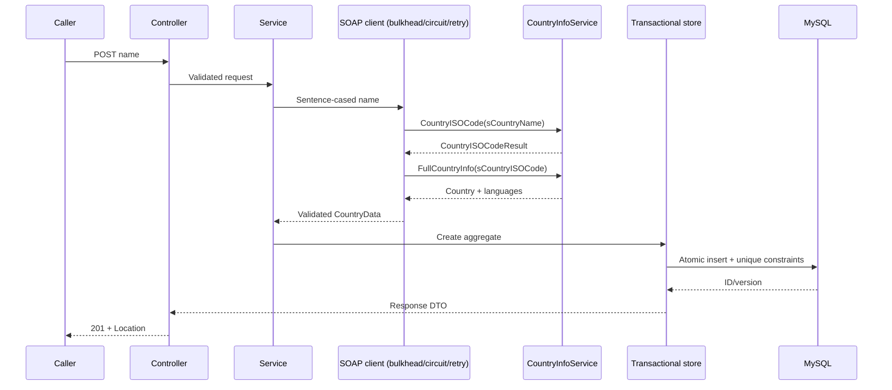

# Design and tradeoffs

## Components and persistence

Controllers handle HTTP/validation; the service orchestrates normalization, integration and fallback; `CountryOperationsService` owns short transactional database operations; the SOAP gateway isolates protocol and resilience; repositories and entities own persistence. SOAP calls complete before a database transaction starts, preventing slow providers from consuming database connections.

CountryInfo is the aggregate root. Languages belong to a country and use cascade/orphan removal. Countries are unique by ISO and name; languages by `(country_id, iso_code)`. Database constraints enforce uniqueness across replicas. DTOs hide persistence state. `@Version` plus a required request version rejects stale updates. Replacing languages retains existing rows by code to avoid transient uniqueness violations; marking the parent updated protects changes affecting only children. Schema migrations are checked in and startup uses validation rather than ad hoc DDL.

Countries are a small bounded domain, so storing languages per country is simpler than a shared many-to-many language catalogue, and permits country-specific names. Lists are paginated, sorted by ID and batch-fetch languages to avoid a per-country query. UTC instants are used for timestamps. Database storage is the source of truth for GET; writes never fabricate provider data.

## Integration and resilience

The checked-in WSDL is the contract. SOAP 1.1 uses the exact namespace, empty SOAPAction, and the documented parameter names. A small handwritten codec handles these two stable operations without generating an entire vendor client; a larger/evolving contract would justify generated JAXB/Spring-WS bindings. DOM parsing is namespace-aware, rejects DTDs/external entities, checks the response structure and validates field lengths/ISO consistency before persistence. SOAP faults and malformed XML are never exposed verbatim to clients. Nil language entries are ignored. A bounded body subscriber cancels reception once a response exceeds 1 MB, before constructing a string or DOM tree.

Per replica: connection timeout 2s, request timeout 4s, up to three attempts with exponential backoff and jitter starting at 200ms. Only transport errors, HTTP 429 and 5xx responses without a SOAP fault retry. Permanent HTTP errors, invalid XML and successful SOAP faults do not retry. Each retry repeats the read-only name/full-info sequence; it cannot duplicate database writes. A circuit breaker counts complete lookup outcomes, with a 10-call window, minimum 5 calls, 50% failure threshold and 30s open period. Unknown-country errors are ignored by the breaker. A semaphore bulkhead admits 20 lookups, including retries, and rejects overflow immediately. The timer tracks individual HTTP attempts and labels use bounded operation/outcome values; retry/fallback counters and circuit/permit gauges aid diagnosis.

Fallback returns the last stored aggregate only when the provider fails and the requested name matches stored data; `X-Data-Stale: true` and timestamps make it explicit. It does not suppress invalid user requests, duplicates, unknown countries or storage failures. No synthetic defaults or retry of database writes. Circuit/bulkhead state is intentionally local to replicas: simple and fast, with aggregate provider concurrency up to replicas × 20.

The WSDL advertises HTTP and the HTTPS endpoint failed during verification. HTTP is the compatible default for this assessment and is configurable using `SOAP_ENDPOINT`. Production should use a verified TLS provider endpoint or a controlled TLS integration proxy. Keep this unauthenticated sample API internal; an external ingress/API gateway must enforce TLS, authentication/authorization, request size limits and rate limiting before public exposure.

## Load and scalability

The application stores no user session state. A Kubernetes Service distributes requests across replicas; HPA scales from 2 to 6 using CPU. Requests/limits and bounded servlet, SOAP and database capacity prevent unlimited work. CPU-only HPA may underreact to blocking I/O: add request rate/inflight or latency metrics via a custom metrics adapter after load testing. Six replicas with pool size 10 use up to 60 database connections, plus surge/admin/migration capacity; budget MySQL connections accordingly. Scale the database independently and use backups/HA, not just more application replicas.

No in-memory country cache is used, avoiding stale cross-replica CRUD reads. Persisted fallback provides a shared, durable snapshot during provider outages. For substantially larger read traffic, a distributed Redis cache can be added with TTL and write invalidation. The requested POST is synchronous: a queue would change its contract to 202 + job polling. Add a bounded queue/workers for bulk imports if needed; avoid using a queue to hide synchronous overload. Use gateway rate limits and the bulkhead today.

Graceful shutdown drains HTTP work for up to 20s inside the 30s pod grace period. Readiness depends on DB health; liveness does not depend on DB/provider health to avoid restart storms. The provider is excluded from readiness so stored CRUD/fallback remains available during its outage. Management port 8081 is separate from the API service and must remain private. JSON logs include request IDs, method/status/duration and SOAP operation/outcome; no credentials or raw SOAP/user payloads are logged.

## Verification boundaries

Unit/local integration tests isolate the public provider and run without MySQL. Real MySQL tests require Docker and repeat the API contract including migrations and language replacement. Kubernetes manifests and container build require Docker/kubectl and an actual cluster to validate runtime behavior. Before production, measure throughput/latency under provider slowdown, saturate bulkheads/pools, exercise concurrent writes and rolling upgrades, and verify alerting/backup recovery. Kubernetes scripts are provided but do not deploy automatically to an unknown cluster.
